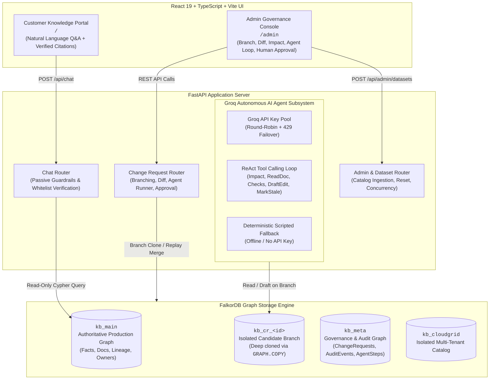

# TruthBranch — Git for Company Knowledge

[](https://falkordb.com/)
[](https://fastapi.tiangolo.com/)
[](https://react.dev/)
[]()
[](LICENSE)

> **A knowledge change is proposed on an isolated branch, investigated through a connected graph, validated against governance rules, drafted into follow-up edits by an autonomous agent, approved by a human, and merged into production with complete lineage and history preserved.**

Built for Hackathon Tracks:
- **Track 1:** Agents That Act on Connected Data
- **Track 3:** Company Brain

---

## 1. Executive Summary & Vision

Modern enterprises suffer from a silent, pervasive failure mode: **Knowledge Drift**.

When a core fact changes — such as a subscription price, an SLA window, or a compliance policy — it is updated in a primary database or announcement memo. However, references to that fact remain quietly stale in dozens of downstream assets: customer FAQs, sales pitch decks, investor updates, CRM support macros, and financial forecast models. Traditional keyword search misses indirect dependencies (e.g. an annual plan calculated as `monthly × 10`, or a board deck citing a quarterly forecast), leading to customer churn, legal vulnerability, and lost revenue.

**TruthBranch** solves this by introducing **"Git for Company Knowledge"**. 

Using **FalkorDB**, TruthBranch structures company knowledge as an authoritative, versioned property graph. When a knowledge mutation is proposed:
1. **Branch:** An isolated candidate branch is instantly cloned using FalkorDB's native `GRAPH.COPY`.
2. **Blast Radius Analysis:** The system traverses multi-hop citation and derivation chains to compute the exact impact set and explains *why* each document is impacted.
3. **Autonomous Agent Assistance:** A Groq-powered AI agent inspects the graph, drafts follow-up text edits, flags downstream documents for review, and runs automated governance checks.
4. **Human-in-the-Loop Approval:** The agent cannot touch production. A human administrator inspects the diff, reviews the checks, and approves the merge.
5. **Atomic Merge:** Validated mutations replay onto production (`kb_main`), previous versions are superseded with immutable `:SUPERSEDES` edges, citations are re-pointed, and the candidate branch is safely deleted.

---

## 2. Why FalkorDB?

TruthBranch relies on FalkorDB as its primary database engine for four core technical reasons:

1. **Sub-10ms Graph Branching (`GRAPH.COPY`):**
   Unlike relational databases or document stores where branching requires heavy table replication or fragile row-level tenant tagging, FalkorDB clones entire production graphs in under 10 milliseconds via `GRAPH.COPY kb_main kb_cr_<id>`. Candidate branches inherit all property indexes and are 100% isolated. Mutations on a branch never leak to production.
2. **Native GraphBLAS Matrix Traversals:**
   Impact analysis requires traversing mixed chains of document citations (`:CITES`), mathematical derivations (`:DERIVED_FROM`), and content cascades. FalkorDB computes these multi-hop linear algebraic operations in sub-millisecond latencies without the join overhead of SQL CTEs.
3. **Readable OpenCypher with Lineage Paths:**
   FalkorDB natively supports OpenCypher functions like `nodes(p)` and `length(p)`, allowing TruthBranch to return human-explainable "why" paths (e.g. `doc:board_deck` → `doc:investor_update` → `doc:revenue_forecast_q4` → `fact:pricing.pro.monthly@v1`) directly to administrators in a single query.
4. **Graph-Native Versioning:**
   FalkorDB allows seamless dynamic re-pointing of directed edges (`DELETE c`, `MERGE (d)-[:CITES]->(new)`), preserving historical audits while instantaneously updating the operational knowledge base.

---

## 3. System Architecture & Dual-Portal Design

TruthBranch provides two complementary portals:
- **Customer Knowledge Portal (`/`):** A customer-facing conversational assistant answering queries grounded strictly in `kb_main` with verified citations and prompt-injection guardrails.
- **Admin Governance Console (`/admin`):** A comprehensive governance workspace where operators inspect knowledge branches, view visual diffs, review AI agent actions, and authorize merges.



*For comprehensive architecture specifications, state machines, and sequence diagrams, see [docs/architecture.md](docs/architecture.md).*

---

## 4. Graph Data Model

The authoritative knowledge graph consists of **5 canonical node types** and **6 directed relationship types**:

```
       [Source] (src:*)
          │
          │ :SOURCED_FROM
          ▼
       [Fact] (fact:*@v1) ───────────[:OWNED_BY]───────────► [Person] (p:*)
          │         ▲                                           ▲
          │         │ :DERIVED_FROM (e.g. rule: "x10")         │
:CITES    │         │                                           │ :OWNED_BY
          ▼         │                                           │
      [Document] (doc:*) ───────────────────────────────────────┘
          │         ▲
          │         │ :DERIVED_FROM
          │         │
          ▼         │
   [Document] (doc:*) ───────────[:PUBLISHED_IN]───────────► [System] (sys:*)
```

- **`Fact`:** Immutable, versioned units of truth (`key`, `version`, `subject`, `attribute`, `value`, `status`).
- **`Document`:** Human-facing content (`title`, `content`, `kind`, `status`, `last_reviewed`).
- **`Person`:** Accountable organizational owners (`name`, `role`, `email`).
- **`Source`:** Evidence and justification (`title`, `kind`, `valid`, `trust`).
- **`System`:** Publishing targets (`name`).

*For full schemas, property types, and constraints, see [docs/graph-schema.md](docs/graph-schema.md).*

---

## 5. Essential Cypher Queries

All graph operations in TruthBranch are powered by explicit, readable OpenCypher queries:

- **Impact Analysis (Multi-Hop Lineage):**
  Traverses direct citations, downstream derived facts, and document cascade chains:
  ```cypher
  MATCH (d1:Document)-[:CITES]->(f:Fact {id: $old_fact_id})
  MATCH (d2:Document)-[:DERIVED_FROM*1..3]->(d1)
  RETURN DISTINCT d2.id AS doc_id, d1.id AS via_doc
  ```
- **Explainable Provenance Path:**
  Extracts the shortest path justifying document inclusion:
  ```cypher
  MATCH p = (d2:Document {id: $doc_id})-[:DERIVED_FROM*0..3]->(d1:Document)-[:CITES]->(f:Fact {id: $old_fact_id})
  RETURN [n IN nodes(p) | n.id] AS path ORDER BY length(p) ASC LIMIT 1
  ```
- **Automated Source Check:**
  ```cypher
  MATCH (s:Source {id: $source_id})
  RETURN s.valid AS valid, s.trust AS trust, s.title AS title
  ```
- **Atomic Re-pointing on Merge:**
  ```cypher
  MATCH (d:Document {id: $doc_id})-[c:CITES]->(old:Fact {id: $old_id})
  MATCH (new:Fact {id: $new_id})
  DELETE c
  MERGE (d)-[:CITES]->(new)
  ```

*For complete Cypher documentation, see [docs/cypher-queries.md](docs/cypher-queries.md).*

---

## 6. Quick Start & Clean-Room Setup

### Prerequisites
- Python 3.11+
- Node.js 18+ and npm
- Docker (for FalkorDB)

### Step 1: Run FalkorDB
Launch the official FalkorDB container mapped to port `6380`:
```bash
docker run -d --name truthbranch-falkordb -p 6380:6379 -p 3000:3000 falkordb/falkordb:latest
```

### Step 2: Backend Setup & Seed
```bash
# Clone the repository
git clone https://github.com/mukundvinayak/truthbranch.git
cd truthbranch

# Setup Python Virtual Environment
python3 -m venv .venv
source .venv/bin/activate
pip install -r backend/requirements.txt

# Configure environment variables
cp .env.example .env

# Seed the default canonical dataset (Lumen Analytics)
python -m backend.app.seed.seed --dataset lumen
```

### Step 3: Run the Backend API Server
```bash
uvicorn backend.app.main:app --host 0.0.0.0 --port 8000 --reload
```
API Documentation will be available at `http://localhost:8000/docs`.

### Step 4: Run the Frontend UI
In a separate terminal:
```bash
cd frontend
npm install
npm run dev
```
Open `http://localhost:5173` for the Customer Portal and `http://localhost:5173/admin` for the Admin Console.

### Step 5: Run the Complete Test Suite
Verify that all 93 invariant and ground-truth tests pass:
```bash
pytest -v
```

---

## 7. Canonical Scenarios Walkthrough

TruthBranch comes with pre-curated ground-truth scenarios demonstrating its governance engine:

### Scenario A: Governed Price Increase ($49 → $59)
- **Action:** Pro monthly price is raised from $49 to $59, justified by an approved Pricing Committee memo (`src:pricing_committee_memo_2026_10`, trust `0.95`).
- **Graph Impact:** Discovers **7 documents** and **1 derived fact** (`pricing.pro.annual` via `x10` rule).
- **Agent Action:** Automatically drafts exact text edits for `pricing_page`, `sales_deck`, and `faq`. Marks unliteral financial models (`support_macro_upgrade`, `investor_update`, `board_deck`) as `NEEDS_REVIEW`. Detects shadow mention in `partner_faq`.
- **Validation:** All checks pass (`CHECKS_PASSED`). Status moves to `READY_FOR_REVIEW`.
- **Merge:** Human approves and merges. `v1` is superseded, `v2` is active, citations are re-pointed, branch is deleted.

### Scenario B: Unverified Source Rejected
- **Action:** Same price increase proposed, but backed by an unverified Slack rumor (`src:slack_rumor_2026_10`, trust `0.20`, `valid: false`).
- **Result:** Automated check `SOURCE_INVALID` triggers. The agent refuses to submit, leaving the Change Request in `BLOCKED` status. Bad data never reaches human reviewers.

### Scenario C: Regional Pricing Contradiction
- **Action:** US monthly price change proposed when a conflicting regional price (`fact:pricing.pro.monthly.eu@v1`, $45) exists in the graph without explicit scoping.
- **Result:** Check `CONTRADICTION` triggers. Blocks until regional policy is harmonized.

### Live Customer Chatbot Demonstration
- **Before Merge:** Customer asks *"How much does Pro cost?"* → Chatbot responds **$49/month** with citation `[doc:faq]`.
- **Merge Scenario A:** Human administrator merges the $59 change request on the Admin Console.
- **After Merge:** Customer asks *"How much does Pro cost now?"* → Chatbot immediately responds **$59/month** with updated citation `[doc:pricing_page]`!

---

## 8. Ground-Truth Verification: Graph Impact vs Keyword Search

To rigorously demonstrate why connected data is required for knowledge governance, TruthBranch evaluates impact analysis against standard keyword search on the Lumen Analytics dataset:

| Target Document | Real Relationship to Fact | FalkorDB Graph Blast Radius | Keyword Search (`"49"`) |
| :--- | :--- | :---: | :---: |
| **Pricing page** (`doc:pricing_page`) | Direct Citation (`:CITES`) | **FOUND** | **FOUND** |
| **Sales deck** (`doc:sales_deck`) | Direct Citation (`:CITES`) | **FOUND** | **FOUND** |
| **Customer FAQ** (`doc:faq`) | Direct Citation (`:CITES`) | **FOUND** | **FOUND** |
| **Q4 revenue forecast** (`doc:revenue_forecast_q4`) | Direct Citation (`:CITES`) | **FOUND** | **FOUND** |
| **Support macro: upgrade** (`doc:support_macro_upgrade`) | Cascade via FAQ (`:DERIVED_FROM`) | **FOUND** | ❌ **MISSED** *(No literal "$49")* |
| **Investor update** (`doc:investor_update`) | Cascade via Forecast (`:DERIVED_FROM`) | **FOUND** | ❌ **MISSED** *(No literal "$49")* |
| **Board deck** (`doc:board_deck`) | Cascade via Investor Update (2 hops) | **FOUND** | ❌ **MISSED** *(No literal "$49")* |
| **Partner FAQ** (`doc:partner_faq`) | Unlinked shadow dependency | ⚠️ **Caught by Literal Scan** | **FOUND** |
| **Careers page** (`doc:careers_page`) | Unrelated ("49 engineers") | 🛡️ **Ignored** | ⚠️ **FALSE POSITIVE** |

**Summary:** Keyword search missed **3 out of 7 impacted documents** (43% error rate) and produced a false positive. FalkorDB achieved **100% precision and recall**.

---

## 9. Groq Autonomous AI Agent Subsystem

TruthBranch incorporates an autonomous agent powered by Groq's high-speed inference engine (`llama-3.3-70b-versatile`):

### Tool Catalog & Safety Boundary
The agent is restricted to a read-and-draft tool catalog:
- `impact_analysis(fact_id)`: Traverses graph blast radius.
- `read_document(doc_id)`: Inspects candidate document text.
- `draft_edit(doc_id, replacement_text)`: Stores candidate edit on branch.
- `mark_stale(doc_id, reason)`: Marks derived documents for review.
- `run_checks()`: Evaluates governance rules against candidate branch.

> [!IMPORTANT]
> **Strict Security Boundary:** The AI agent possesses **zero tools** to approve or merge. It cannot modify `kb_main` directly. Only an authenticated human administrator can approve and execute a merge.

### Groq API Key Pool & Transparent Failover
- TruthBranch implements a dynamic key pool (`groq_pool.py`) that reads multiple keys (`GROQ_API_KEY`, `GROQ_API_KEY_1`, `GROQ_API_KEY_2`) and dispatches requests in a round-robin cycle.
- If an HTTP 429 rate limit is encountered, the agent transparently fails over to the next available key without interrupting the user.
- If no API keys are provided or keys are exhausted, the agent automatically runs in **Deterministic Scripted Mode**, guaranteeing 100% test reliability.

---

## 10. Explicit Limitations & Scope Boundaries

1. **Single Active Branch per Company:** TruthBranch operates on a single active candidate branch per dataset at a time. Multi-branch merging is not supported.
2. **Synthetic Dataset Ground Truth:** The Lumen Analytics and CloudGrid datasets are synthetic, designed with known ground truth to allow rigorous mathematical validation of recall and precision.
3. **Shadow Dependencies:** Documents lacking formal `:CITES` edges (such as `doc:partner_faq`) are detected via regex literal value scanning rather than graph adjacency.
4. **Unauthenticated Admin API:** Authentication and role-based access control (RBAC) are simulated for hackathon demonstration purposes.

---

## 11. AI Usage Disclosure

TruthBranch was designed and engineered with assistance from modern AI coding tools:
- **Architecture & Code Authoring:** Google Antigravity IDE and Cursor assisted with boilerplate generation, Pytest test cases, and TypeScript React components.
- **Agent Reasoning:** Groq API (`llama-3.3-70b-versatile`) powers the autonomous ReAct tool-calling agent.
- All core Cypher queries, graph state machines, optimistic concurrency controls, and safety invariants were architected, tested, and verified by the development team.

---

## 12. License

TruthBranch is open-source software licensed under the [MIT License](LICENSE).
