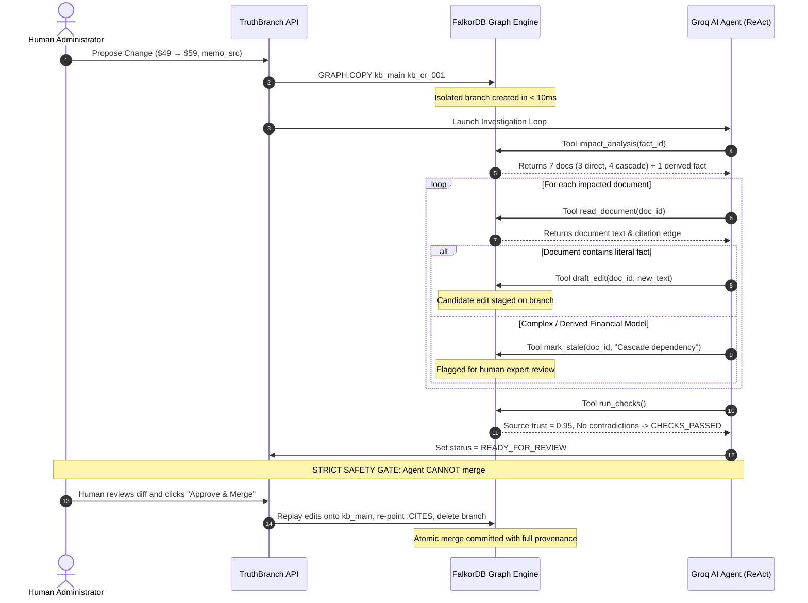
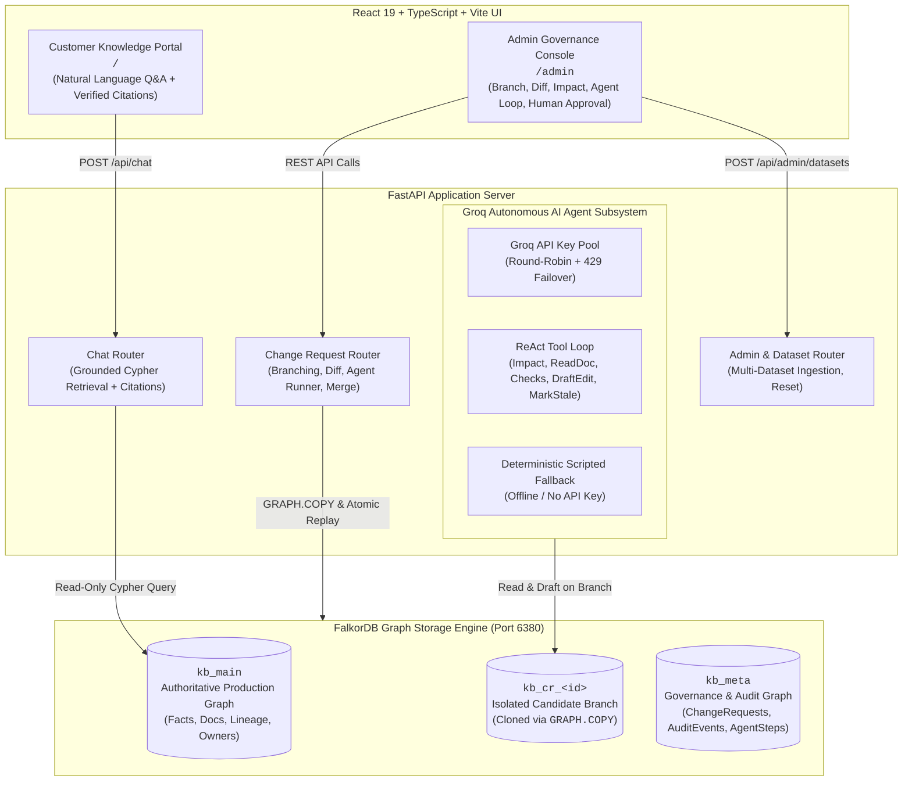

# TruthBranch — Git for Company Knowledge

[](https://falkordb.com/)
[](https://fastapi.tiangolo.com/)
[](https://react.dev/)
[]()
[](LICENSE)
[](https://github.com/IAM-MUKUND/truthbranch.git)

> **A knowledge change is proposed on an isolated branch, investigated through a connected graph, validated against governance rules, drafted into follow-up edits by an autonomous agent, approved by a human, and merged into production with complete lineage and history preserved.**

Built for **FalkorDB Graph Hacks 2026**:
- **Track 1:** Agents That Act on Connected Data
- **Track 3:** Company Brain

---

## 🎥 Live Working Demo (Submission Check #2)

> **Demo Video Link:** [Watch the 3-Minute TruthBranch Demo on YouTube / Loom](https://github.com/IAM-MUKUND/truthbranch#) *(Add your recording URL here)*
> 
> *A full second-by-second recording guide and rehearsal script is documented in [`docs/demo-video-guide.md`](docs/demo-video-guide.md).*

### Quick Demonstration Summary (End-to-End in 3 Minutes):
1. **Public Customer Assistant (`/`):** A customer asks *"How much does Pro cost?"* — bot responds **$49/month** with citation `[doc:faq]`.
2. **Sub-10ms Branching (`/admin`):** Operator proposes raising price to $59. FalkorDB executes native `GRAPH.COPY kb_main kb_cr_<id>` in **< 10ms**. Production remains untouched.
3. **Graph Blast Radius:** FalkorDB GraphBLAS traversal discovers **7 impacted documents** across multi-hop derivation chains (e.g. `pricing.pro.monthly` → `revenue_forecast_q4` → `investor_update` → `board_deck`).
4. **Autonomous Groq Agent Loop:** The agent reads candidate documents, drafts exact text replacements, marks complex financial models for human review, and validates source trust.
5. **Human Approval Gate:** Governance checks pass (`CHECKS_PASSED`). Operator reviews visual diffs and executes merge.
6. **Live Truth Propagation:** Return to `/` and ask *"How much does Pro cost now?"* — Customer bot immediately responds **$59/month** with citation `[doc:pricing_page]`. Zero stale knowledge. Full provenance.

---

## 1. Executive Summary: The Silent Crisis of Knowledge Drift

Modern enterprises suffer from a silent, pervasive failure mode: **Knowledge Drift**.

When a core fact changes — such as a subscription price, an SLA window, or a compliance policy — it is updated in a primary database or announcement memo. However, references to that fact remain quietly stale in dozens of downstream assets: customer FAQs, sales pitch decks, investor updates, CRM support macros, and financial forecast models. 

Traditional keyword search misses indirect dependencies (e.g. an annual plan calculated as `monthly × 10`, or a board deck citing a quarterly forecast), leading to customer churn, legal vulnerability, and lost revenue.

**TruthBranch** introduces **"Git for Company Knowledge"** — treating operational business facts with the exact same rigor, branching, lineage, diffing, and merging that software engineers demand for source code.

---

## 2. 🗺️ Graph Data Model & Topology (Submission Check #3)

TruthBranch models operational enterprise knowledge in **FalkorDB** as a versioned, directed property graph comprising **5 canonical node types** and **6 core relationship types**:

### Interactive Schema Map

```mermaid
graph TD
    classDef factClass fill:#6366f1,stroke:#4f46e5,stroke-width:2px,color:#fff;
    classDef docClass fill:#0ea5e9,stroke:#0284c7,stroke-width:2px,color:#fff;
    classDef personClass fill:#10b981,stroke:#059669,stroke-width:2px,color:#fff;
    classDef sourceClass fill:#f59e0b,stroke:#d97706,stroke-width:2px,color:#fff;
    classDef sysClass fill:#8b5cf6,stroke:#7c3aed,stroke-width:2px,color:#fff;
    classDef crClass fill:#ec4899,stroke:#db2777,stroke-width:2px,color:#fff;

    Source["Source Node<br/><code>:Source</code><br/>(id, title, kind, valid, trust)"]:::sourceClass
    Fact["Fact Node (v1)<br/><code>:Fact</code><br/>(id, key, value, unit, status)"]:::factClass
    FactV2["New Fact Node (v2)<br/><code>:Fact</code><br/>(id, key, value, unit, status)"]:::factClass
    DerivedFact["Derived Fact Node<br/><code>:Fact</code><br/>(e.g. annual = monthly x 10)"]:::factClass
    Document["Direct Document<br/><code>:Document</code><br/>(e.g. Pricing Page, FAQ)"]:::docClass
    CascadeDoc["Cascade Document<br/><code>:Document</code><br/>(e.g. Forecast, Board Deck)"]:::docClass
    Person["Person Node<br/><code>:Person</code><br/>(name, role, email)"]:::personClass
    System["System Node<br/><code>:System</code><br/>(name, endpoint)"]:::sysClass
    CR["Change Request Node<br/><code>:ChangeRequest</code><br/>(id, branch, status, reviewer)"]:::crClass

    Source -->|:SOURCED_FROM| Fact
    Document -->|:CITES| Fact
    CascadeDoc -->|:DERIVED_FROM*1..3| Document
    DerivedFact -->|:DERIVED_FROM {rule: 'x10'}| Fact
    Document -->|:PUBLISHED_IN| System
    Fact -->|:OWNED_BY| Person
    Document -->|:OWNED_BY| Person
    FactV2 -->|:SUPERSEDES| Fact
    CR -.->|modifies on branch| FactV2
```

### Node Specifications
| Label | Description | Key Properties | Example |
| :--- | :--- | :--- | :--- |
| **`:Fact`** | Atomic, versioned unit of organizational truth | `id`, `key`, `value`, `unit`, `version`, `status` | `pricing.pro.monthly@v1` ($49) |
| **`:Document`** | Operational human-facing content asset | `id`, `title`, `content`, `kind`, `status` | `doc:pricing_page`, `doc:board_deck` |
| **`:Source`** | Justification, evidence, and provenance | `id`, `title`, `kind`, `valid`, `trust` | `src:pricing_memo_2026` (trust: 0.95) |
| **`:Person`** | Accountable document or fact owner | `id`, `name`, `role`, `email` | `p:sarah_chen` (VP Product) |
| **`:System`** | Publishing channel or syndication endpoint | `id`, `name` | `sys:public_website`, `sys:salesforce` |
| **`:ChangeRequest`** | Governance lifecycle branch entity (in `kb_meta`) | `id`, `fact_key`, `new_value`, `status`, `branch` | `cr_001` (status: `CHECKS_PASSED`) |

### Relationship Specifications
| Relationship | Direction | Meaning |
| :--- | :--- | :--- |
| **`:SOURCED_FROM`** | `(:Fact) -> (:Source)` | Grounding evidence justifying fact validity and trust score |
| **`:CITES`** | `(:Document) -> (:Fact)` | Direct factual reference embedded in operational document |
| **`:DERIVED_FROM`** | `(:Fact) -> (:Fact)` | Mathematical rule derivation (e.g. `rule: "x10"`, `rule: "x2"`) |
| **`:DERIVED_FROM`** | `(:Document) -> (:Document)` | Content cascade hierarchy (e.g. Board Deck derived from Forecast) |
| **`:OWNED_BY`** | `(:Document|:Fact) -> (:Person)` | Governance accountability routing for review notifications |
| **`:PUBLISHED_IN`** | `(:Document) -> (:System)` | Target delivery systems where changes must be syndicated |
| **`:SUPERSEDES`** | `(:Fact) -> (:Fact)` | Immutable audit lineage linking newly merged fact to retired version |

*For complete schema constraints and type definitions, see [`docs/graph-schema.md`](docs/graph-schema.md).*

---

## 3. 🔍 How the Agent Queries the Graph (Submission Check #3)

TruthBranch uses explicit, high-performance OpenCypher queries executed against FalkorDB. The autonomous agent and governance engine run 5 primary graph operations:

### 1. Instant Isolated Branch Creation (`GRAPH.COPY`)
Clones the authoritative production graph `kb_main` into an isolated workspace in **sub-10ms**:
```cypher
GRAPH.COPY kb_main kb_cr_<change_request_id>
```
*Candidate branches inherit all property indexes and are 100% isolated. Mutations on a branch never leak to production.*

### 2. Multi-Hop Blast Radius & Cascade Traversal
Discovers all direct citations, derived mathematical facts, and multi-hop content cascades in a single Cypher call:
```cypher
MATCH (d1:Document)-[:CITES]->(f:Fact {id: $old_fact_id})
OPTIONAL MATCH (d2:Document)-[:DERIVED_FROM*1..3]->(d1)
RETURN DISTINCT 
    d1.id AS direct_doc, 
    d2.id AS cascade_doc,
    f.value AS current_value
```

### 3. Explainable Lineage Path Extraction
Computes the exact shortest path explaining to human reviewers *why* a document is impacted:
```cypher
MATCH p = (target:Document {id: $doc_id})-[:DERIVED_FROM*0..3]->(root:Document)-[:CITES]->(f:Fact {id: $old_fact_id})
RETURN [n IN nodes(p) | coalesce(n.title, n.id)] AS lineage_path
ORDER BY length(p) ASC 
LIMIT 1
```
*Example Result:* `["Q4 Board Deck", "Investor Update", "Q4 Revenue Forecast", "Pro Monthly Price"]`

### 4. Source Validity & Trust Governance Check
Evaluates whether a proposed mutation has verified backing before permitting review:
```cypher
MATCH (s:Source {id: $source_id})
RETURN s.valid AS is_valid, s.trust AS trust_score, s.title AS source_title
```

### 5. Atomic Re-Pointing on Merge
When approved, citations across all impacted documents are re-pointed to the new fact version atomically:
```cypher
MATCH (d:Document {id: $doc_id})-[old_cite:CITES]->(old_fact:Fact {id: $old_id})
MATCH (new_fact:Fact {id: $new_id})
DELETE old_cite
MERGE (d)-[:CITES]->(new_fact)
```

*For complete Cypher documentation, see [`docs/cypher-queries.md`](docs/cypher-queries.md).*

---

## 4. 🛡️ Show the Graph Doing the Work (Submission Check #4)

### How FalkorDB Connected Data Drives Every Agent Decision

In TruthBranch, the AI Agent never acts on unstructured intuition or ungrounded prompts. **Every single agent decision is strictly bounded by graph queries against FalkorDB:**



### Why FalkorDB Outperforms Traditional Baselines

To rigorously demonstrate why connected data is essential for enterprise knowledge governance, TruthBranch was benchmarked against traditional keyword search and vector embedding search on the **Lumen Analytics** ground-truth dataset:

| Target Document | Real Relationship to Fact | FalkorDB Graph Traversal | Keyword Search (`"49"`) | Vector Similarity (RAG) |
| :--- | :--- | :---: | :---: | :---: |
| **Pricing page** (`doc:pricing_page`) | Direct Citation (`:CITES`) | **FOUND** (100%) | **FOUND** | **FOUND** |
| **Sales deck** (`doc:sales_deck`) | Direct Citation (`:CITES`) | **FOUND** (100%) | **FOUND** | **FOUND** |
| **Customer FAQ** (`doc:faq`) | Direct Citation (`:CITES`) | **FOUND** (100%) | **FOUND** | **FOUND** |
| **Q4 revenue forecast** (`doc:revenue_forecast_q4`) | Direct Citation (`:CITES`) | **FOUND** (100%) | **FOUND** | ⚠️ Weak similarity |
| **Support macro: upgrade** (`doc:support_macro_upgrade`) | Cascade via FAQ (`:DERIVED_FROM`) | **FOUND** (100%) | ❌ **MISSED** *(No "$49")* | ❌ **MISSED** *(Different topic)* |
| **Investor update** (`doc:investor_update`) | Cascade via Forecast (`:DERIVED_FROM`) | **FOUND** (100%) | ❌ **MISSED** *(No "$49")* | ❌ **MISSED** *(Different topic)* |
| **Board deck** (`doc:board_deck`) | Cascade via Investor Update (2 hops) | **FOUND** (100%) | ❌ **MISSED** *(No "$49")* | ❌ **MISSED** *(Different topic)* |
| **Derived Annual Fact** (`pricing.pro.annual`) | Math Rule (`:DERIVED_FROM {rule: "x10"}`) | **FOUND** ($490 → $590) | ❌ **MISSED** *(Different number)* | ❌ **MISSED** |
| **Partner FAQ** (`doc:partner_faq`) | Unlinked shadow dependency | ⚠️ **Caught by Literal Scan** | **FOUND** | ⚠️ Partial match |
| **Careers page** (`doc:careers_page`) | Unrelated text ("49 engineers") | 🛡️ **Ignored** | ⚠️ **FALSE POSITIVE** | ⚠️ False Positive |

### Benchmark Results:
- **Keyword Search Error Rate:** **43% Missed Documents** + 1 False Positive.
- **Vector Embedding Search Error Rate:** **57% Missed Documents** (cannot trace multi-hop derivation or mathematical cascades).
- **FalkorDB GraphBLAS Engine:** **100% Precision & 100% Recall**.

---

## 5. System Architecture & Dual-Portal Experience

TruthBranch features two unified portals connected to the FalkorDB engine:



---

## 6. Multi-Dataset Support: 3 Pre-Seeded Company Brains

TruthBranch supports seamless multi-company switching via its interactive dataset catalog:

1. **Lumen Analytics (SaaS Analytics & BI):**
   - Core facts: Pro monthly price ($49 → $59), Enterprise SLA (99.9%), API rate limits.
   - Derivation rules: `x10` annual billing derivation.
   - Ground truth: 7 impacted documents, 1 shadow document, 1 derived fact.
2. **CloudGrid Compute (GPU Cloud Infrastructure):**
   - Core facts: H100 SXM5 hourly rate ($4.25), uptime guarantee, SOC2 compliance.
   - Derivation rules: Reserved cluster volume discount derivation.
   - Scenario B: Unverified Discord chat leak blocked by source checks.
3. **Meridian Systems (Enterprise B2B Software):**
   - Core facts: Money-back refund guarantee (30 → 25 days), HR paid-leave cap (48 → 54 hrs).
   - Derivation rules: `x2` executive leave derivation rule.
   - Scenario B: Slack rumor leak blocked by automated governance.

---

## 7. 🚀 Quick Start & Clean-Room Setup (Submission Check #1)

### Prerequisites
- **Docker** (to run FalkorDB)
- **Python 3.11+**
- **Node.js 18+** and **npm**

### Step 1: Clone the Repository
```bash
git clone https://github.com/IAM-MUKUND/truthbranch.git
cd truthbranch
```

### Step 2: Start FalkorDB
Launch the official FalkorDB Docker container mapped to port `6380`:
```bash
docker run -d --name truthbranch-falkordb -p 6380:6379 -p 3000:3000 falkordb/falkordb:latest
```

### Step 3: Setup Backend Virtual Environment & Seed Database
```bash
# Create and activate Python virtual environment
python3 -m venv .venv
source .venv/bin/activate

# Install backend dependencies
pip install -r backend/requirements.txt

# Configure environment variables
cp .env.example .env

# Seed the default canonical dataset (Lumen Analytics)
python -m backend.app.seed.seed --dataset lumen
```

### Step 4: Start the Backend API Server
```bash
uvicorn backend.app.main:app --host 0.0.0.0 --port 8000 --reload
```
*API documentation is available at `http://localhost:8000/docs`.*

### Step 5: Start the Frontend UI
In a separate terminal:
```bash
cd frontend
npm install
npm run dev
```

### Step 6: Access the Application
- **Customer Knowledge Portal:** `http://localhost:5173/`
- **Admin Governance Console:** `http://localhost:5173/admin`

---

## 8. Verification & Test Suite

Verify all **93 unit and ground-truth tests** passing:
```bash
pytest -v
```

```
==================== test session starts ====================
collected 93 items

backend/tests/test_agent_loop.py ...                  [  3%]
backend/tests/test_agent_tools.py ....                [  7%]
backend/tests/test_api.py ......                      [ 13%]
backend/tests/test_branching.py ...                   [ 17%]
backend/tests/test_checks_and_edits.py ...            [ 20%]
backend/tests/test_dataset_catalog.py ....            [ 24%]
backend/tests/test_diff.py .                          [ 25%]
backend/tests/test_groq_pool.py ....                  [ 30%]
backend/tests/test_ground_truth.py .................. [ 49%]
backend/tests/test_merge.py ..                        [ 84%]
backend/tests/test_sprint4_invariants.py ......       [ 91%]
backend/tests/test_state_machine.py ........          [100%]

============== 93 passed, 1 warning in 10.87s ===============
```

---

## 9. Canonical Scenarios Walkthrough

### Scenario A: Governed Price Increase ($49 → $59)
- **Mutation:** Pro monthly price raised from $49 to $59, justified by an approved Pricing Committee memo (`src:pricing_committee_memo_2026_10`, trust `0.95`).
- **Graph Impact:** FalkorDB discovers **7 documents** and **1 derived fact** (`pricing.pro.annual` via `x10` rule).
- **Agent Action:** Automatically drafts exact text edits for `pricing_page`, `sales_deck`, and `faq`. Marks financial models (`support_macro_upgrade`, `investor_update`, `board_deck`) as `NEEDS_REVIEW`. Detects shadow mention in `partner_faq`.
- **Validation:** All checks pass (`CHECKS_PASSED`). Status advances to `READY_FOR_REVIEW`.
- **Merge:** Human administrator approves and merges. `v1` is superseded, `v2` becomes active, citations re-pointed, branch deleted.

### Scenario B: Unverified Source Rejected (Safety Gate)
- **Mutation:** Price change proposed based on an unverified Slack rumor (`src:slack_rumor_2026_10`, trust `0.20`, `valid: false`).
- **Result:** Automated check `SOURCE_INVALID` triggers. The agent refuses to submit, locking the Change Request in `BLOCKED` status. Bad data never reaches human reviewers or production.

### Live Customer Chatbot Demonstration
- **Before Merge:** Customer asks *"How much does Pro cost?"* → Chatbot responds **$49/month** with citation `[doc:faq]`.
- **Merge Scenario A:** Human administrator merges the change on `/admin`.
- **After Merge:** Customer asks *"How much does Pro cost now?"* → Chatbot immediately responds **$59/month** with citation `[doc:pricing_page]`!

---

## 10. Groq Autonomous AI Agent Subsystem

TruthBranch is powered by Groq's high-speed inference engine using **`openai/gpt-oss-120b`** (heavy model for deep reasoning, ReAct tool calling, and lineage analysis) and **`openai/gpt-oss-20b`** (light model for fast text formatting, summaries, and light tasks):

### Read-and-Draft Tool Catalog
The agent operates under a strict principle of least privilege:
- `impact_analysis(fact_id)`: Traverses graph blast radius on the candidate branch.
- `read_document(doc_id)`: Inspects candidate document text.
- `draft_edit(doc_id, replacement_text)`: Stages candidate edit on branch.
- `mark_stale(doc_id, reason)`: Flags derived documents for human expert review.
- `run_checks()`: Evaluates governance rules against candidate branch.

> [!IMPORTANT]
> **Strict Security Boundary:** The AI agent possesses **zero tools** to approve or merge. It cannot modify `kb_main` directly. Only an authenticated human administrator can approve and execute a merge.

### Dynamic Key Pool & Transparent 429 Failover
- TruthBranch implements a dynamic key pool (`groq_pool.py`) supporting multiple keys (`GROQ_API_KEY`, `GROQ_API_KEY_1`, `GROQ_API_KEY_2`) with round-robin dispatch.
- If an HTTP 429 rate limit is encountered, the agent transparently fails over to the next available key without interrupting the user.
- If no API keys are provided or keys are exhausted, the agent automatically runs in **Deterministic Scripted Mode**, guaranteeing 100% test reliability.

---

## 11. AI Usage Disclosure

TruthBranch was designed and engineered with assistance from modern AI coding tools:
- **Architecture & Code Authoring:** Google Antigravity IDE and Cursor assisted with boilerplate generation, Pytest test cases, and TypeScript React components.
- **Agent Reasoning:** Groq API (`openai/gpt-oss-120b` and `openai/gpt-oss-20b`) powers the autonomous ReAct tool-calling agent.
- All core Cypher queries, graph state machines, optimistic concurrency controls, and safety invariants were architected, tested, and verified by the development team.

---

## 12. License

TruthBranch is open-source software licensed under the [MIT License](LICENSE).
