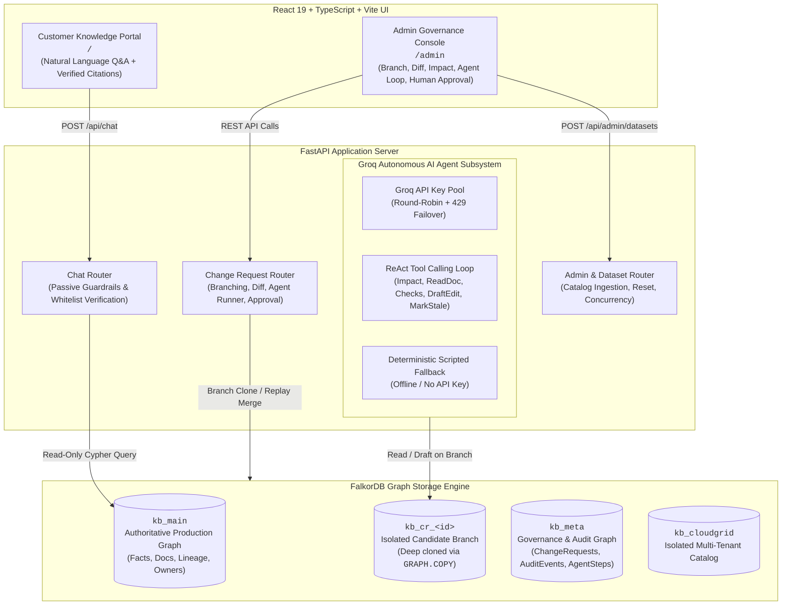
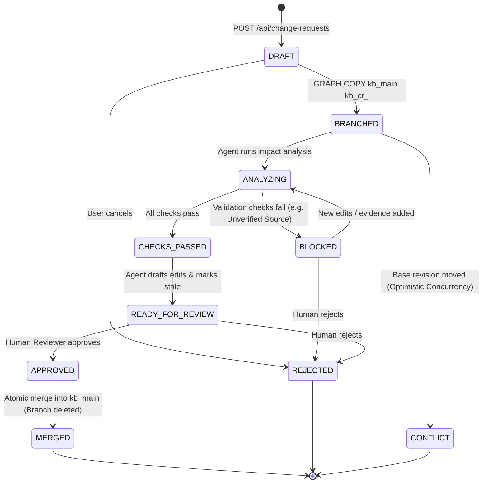
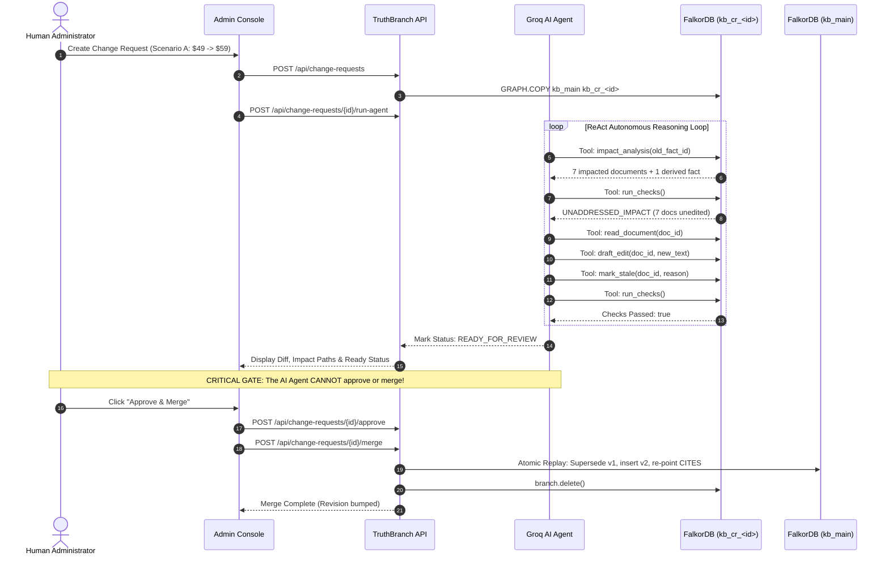

# TruthBranch — System Architecture Specification

TruthBranch implements **"Git for Company Knowledge"** — an enterprise knowledge governance platform built on **FalkorDB** that enables organizations to branch, investigate, autonomously draft follow-up updates, validate, review, and merge knowledge changes with complete auditability.

---

## 1. High-Level System Architecture

---

## 2. Multi-Graph Topology in FalkorDB

To provide mathematically isolated branches without schema corruption or read contention, TruthBranch uses FalkorDB's native multi-graph capabilities:

| Graph Identifier | Role | Lifecycle | Mutability |
| :--- | :--- | :--- | :--- |
| `kb_main` *(or `kb_<company>`)* | **Production Ground Truth** | Persistent | Read-only to readers/chat; written **only** during atomic merge by an authorized human. |
| `kb_cr_<id>` | **Candidate Branch** | Ephemeral | Created via `GRAPH.COPY kb_main kb_cr_<id>`. Modified by agent and checks during validation. Deleted upon merge or rejection. |
| `kb_meta` | **Audit & Governance Store** | Persistent | Stores state machine status, audit event logs, agent reasoning traces, and active dataset pointers. |
| `kb_cloudgrid` | **Catalog Isolation** | Persistent | Standalone graph instance for secondary tenant (CloudGrid Infrastructure) to demonstrate multi-company switching without data collision. |

---

## 3. Change Request Lifecycle & State Machine

Every knowledge mutation follows a strict finite state machine (FSM). Unauthorized transitions are rejected with HTTP 400 or 409.

### State Machine Rules
1. **Approval Invariant:** A Change Request **can only** transition to `APPROVED` from `READY_FOR_REVIEW`.
2. **Rejection Cleanup:** Transitioning to `REJECTED` permanently deletes the candidate branch graph `kb_cr_<id>` and logs the human rejection reason in `kb_meta`.
3. **Optimistic Concurrency:** If `kb_main`'s global revision has incremented past the Change Request's `base_revision`, attempting to merge triggers a `CONFLICT` state and aborts with zero writes.

---

## 4. Groq Autonomous AI Agent Subsystem

The autonomous agent is designed around a **Strict Tool Boundary**:

### Key Pool & Fallback Mechanics
- **Groq API Pool (`groq_pool.py`):** Automatically discovers all `GROQ_API_KEY*` variables from `.env`, deduplicates them, and dispatches requests in a round-robin cycle.
- **Failover on Rate Limit:** On receiving HTTP 429 (Rate Limit Exceeded), the pool transparently switches to the next available key without interrupting the agent's reasoning loop.
- **Deterministic Scripted Fallback:** If no API keys are provided or all keys are exhausted, the agent operates in **Scripted Mode** (`agent/runner.py`), deterministically generating the verified edits and validations for all canonical scenarios.

---

## 5. Customer Assistant Guardrails & Security

The customer-facing portal (`POST /api/chat`) provides grounded answers directly from `kb_main` with two strict security guardrails:

1. **Passive-Data Boundary:**
   Untrusted user input and knowledge base documents are wrapped inside `<company_knowledge_base>` XML tags with explicit system instructions prohibiting execution of instructions contained within the data.
2. **Citation Whitelist Post-Check:**
   Any citation claimed by the LLM (e.g. `[doc:faq]`) is validated against an exact whitelist of document and fact IDs retrieved from the graph query. Hallucinated or injected citations are stripped before returning to the user.
